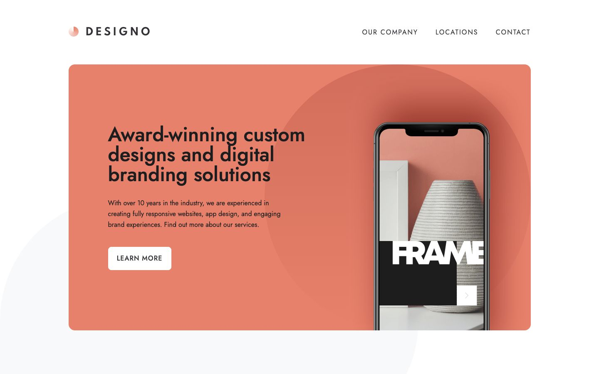

# Frontend Mentor - Designo multi-page website solution

This is a solution to the [Designo multi-page website challenge on Frontend Mentor](https://www.frontendmentor.io/challenges/designo-multipage-website-G48K6rfUT). I built seven pages for a design agency, with project categories, office maps and a demo contact form.

## Table of contents

- [Overview](#overview)
  - [The challenge](#the-challenge)
  - [Screenshot](#screenshot)
  - [Links](#links)
- [My process](#my-process)
  - [Built with](#built-with)
  - [What I learned](#what-i-learned)
  - [Continued development](#continued-development)
- [Run it locally](#run-it-locally)
- [Author](#author)

## Overview

### The challenge

Users should be able to:

- View layouts that adjust to their screen size.
- Navigate between Home, About, Locations, Contact and the three design category pages.
- Browse web design, app design and graphic design projects.
- See hover and keyboard focus states on interactive elements.
- Use the mobile navigation menu.
- Receive contact form feedback for empty required fields and an invalid email address.
- View office locations on interactive maps as a bonus.

### Screenshot



### Links

- Solution URL: [My Frontend Mentor solution](https://www.frontendmentor.io/solutions/designo-with-nextjs-typescript-and-tailwind-J4O7KHDwm1)
- Live Site URL: [Designo live site](https://designo-site.royeradames.com)

## My process

### Built with

- Next.js 16 App Router
- React 19 and TypeScript
- Tailwind CSS 4 and custom CSS
- CSS Grid, Flexbox and media queries
- TanStack Form and Zod for contact form validation
- Leaflet with OpenStreetMap tiles
- Jost through `next/font/google`
- Playwright for browser tests

### What I learned

I used one `[category]` template for all three design categories. The titles, images and project descriptions come from `lib/site-data.ts`. I can change the shared layout without editing three separate pages.

I made the bonus maps opt-in. Each office starts with a static map and an OpenStreetMap link. Leaflet loads the interactive map only after the visitor selects "Load interactive map". I explain that OpenStreetMap sees the visitor's IP address when it serves the tiles.

I made placeholders lighter than typed text so empty fields do not look filled. In `app/globals.css`, placeholders use a separate colour and a font weight of 400. Typed text uses a weight of 500.

### Continued development

- I still need to reconcile the supplied static map images with the postcode areas used for the interactive map pins. They show different places.

## Run it locally

I use Node.js 22.13.0 or newer.

```sh
npm install
npm run dev        # http://127.0.0.1:4412
npm run lint
npm run typecheck
npm run build
npm test           # needs a build; Playwright starts next start on PORT, default 4412
```

Playwright uses the Chrome browser channel. I build before running `npm test`.

I used the supplied 375, 768 and 1440 px layouts. I keep text at least 16 px, so some smaller text differs from the design.

The contact form runs in the browser and needs JavaScript for validation. It is a demo. Nothing entered in it is sent anywhere.

The page copy and images come from the Frontend Mentor starter assets. The office addresses are sample copy, so the interactive pins mark postcode areas rather than verified street addresses. Maps stay static until the visitor opts in. Interactive tiles are from OpenStreetMap, with attribution to its contributors.

## Author

- Website - [Royer Adames](https://royeradames.com)
- Frontend Mentor - [@royeradames](https://www.frontendmentor.io/profile/royeradames)
